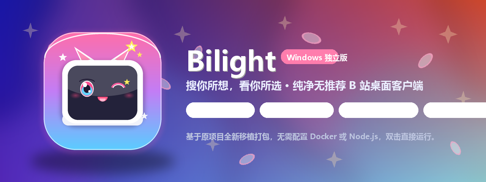

<p align="center">
  
</p>

# Bilight (纯净桌面客户端)

搜你所想，看你所选。

Bilight 是一个只保留搜索与关注的纯净 B 站桌面客户端，去掉了推荐、热搜、排行榜和自动连播。支持 Windows 与 macOS 笔记本双平台，开箱即用。

---

## 优化与改进

相较于原版，桌面版做了以下改动：

- **双平台原生支持**：提供 Windows 绿色独立版与 macOS 原生 `.dmg` 安装镜像（完整适配 Apple Silicon M 系列与 Intel 芯片）。
- **轻量瘦身优化**：深度裁剪运行时冗余组件与非必要语言包，内核体积缩减超过 40%，运行更轻快。
- **画质与高帧率支持**：解除仅允许 AVC(H.264) 的限制，支持 HEVC(H.265) 与 AV1 现代高画质流，流畅播放 4K 超清、1080P 高码率与 60fps 高帧率视频。
- **播放缓冲优化**：媒体分片提升至 2MB 并支持 6 路并发，前置缓冲时间扩至 30~60 秒，首帧起播延迟缩短至约 0.5 秒，暂停时持续后台缓冲。
- **目录自包含与数据独立**：Windows 版凭据与缓存全部自包含于程序目录下的 `data/` 目录；macOS 版严格遵循系统规范收敛于 Application Support。
- **桌面端体验细节**：支持单实例互斥（重复打开自动置顶已有窗口）、退出时记忆窗口大小与位置、支持全屏与快捷键控制。
- **萌系图标定制**：采用二次元猫耳小电视立绘图标，内置进应用与安装包。

---

## 界面预览

### 首页搜索


### 关注动态


### UP 主空间与合集


---

## 下载与使用

从 [Releases 页面](https://github.com/zhaominyi190/Bilight/releases) 获取最新版本：

### Windows 用户
1. 下载 `Bilight-v0.1.4-Windows-x64.zip` 并解压。
2. 双击运行 `Bilight.exe`。
3. 扫码或短信登录已有的 B 站账号。

```text
Bilight/
├── Bilight.exe     # 启动程序
├── core/           # 运行库与依赖组件
└── data/           # 用户登录凭据与缓存（首次启动后自动生成）
```

### macOS 笔记本用户
1. 苹果芯片（M1 / M2 / M3 / M4 等）：下载 `Bilight-0.1.4-arm64.dmg`。
2. Intel 芯片 Mac：下载 `Bilight-0.1.4-x64.dmg`。
3. 打开 `.dmg` 镜像，将 Bilight 拖入 Applications（应用程序）文件夹即可。

---

## 本地编译构建

如果想从源码自己编译：

```bash
# 1. 克隆代码
git clone https://github.com/zhaominyi190/Bilight.git
cd Bilight

# 2. 安装依赖
npm install

# 3. 编译前端与服务端
npm run build

# 4. 打包客户端
npm run build:windows   # 打包 Windows 独立绿色客户端
npm run build:mac       # 打包 macOS DMG (需在 macOS 系统下运行)
```

---

## 致谢与声明

- 本项目基于 [Ownhelm/Bilight](https://github.com/Ownhelm/Bilight) 移植与扩展，遵循 MIT 开源许可。
- 视频播放器基于 ArtPlayer 与 dash.js。
- 本项目为个人学习与非盈利开源研究，并非哔哩哔哩官方客户端。使用时请遵守相关平台规则与版权规范。
