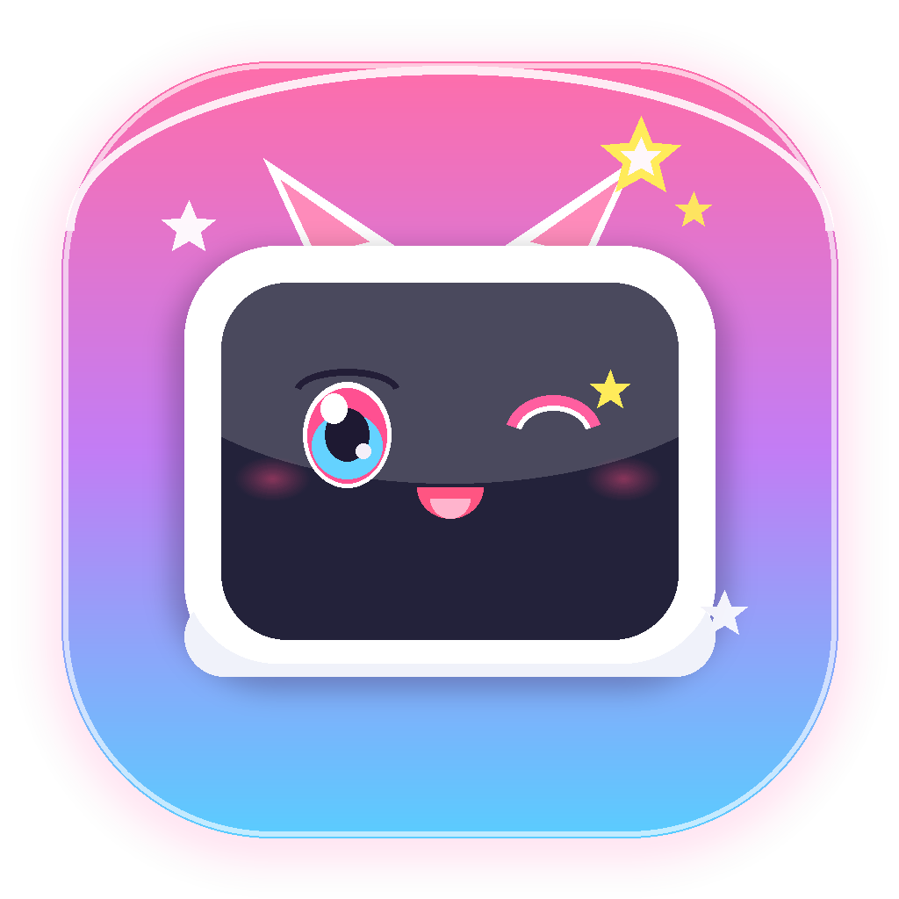

<p align="center"></p>
<h1 align="center">Bilight</h1>
<p align="center"><strong>搜你所想，看你所选。</strong></p>
<p align="center">一个只保留搜索与关注的纯净 B 站客户端。支持 Windows 独立免安装桌面端、手机端（iPhone／安卓）与本地 Docker 部署。</p>
<p align="center">
  
  
  
  
</p>

> [!IMPORTANT]
> Bilight 是个人学习与技术研究项目，并非哔哩哔哩官方客户端，与哔哩哔哩无隶属或合作关系。项目依赖的非官方接口可能随时变更或失效；使用时请遵守平台规则、版权要求与所在地法律，不得用于绕过付费、隐私保护或其他访问控制。

## 为什么做 Bilight

本来只是想搜一个视频，打开首页，却被推荐带到了另一个地方。一个接着一个，最后忘记了自己为什么打开 B 站。

Bilight 的起点很简单：**我想继续看 B 站，但想由自己决定看什么。**

打开后，只有一个搜索框。想看什么就搜，想跟进谁就关注谁。保留视频、UP 主、合集、收藏和观看历史这些有明确目的的入口，去掉推荐、热搜、榜单和自动连播。视频结束，就停在那里。

它不是一个让人刷得更久的客户端，而是希望让“看完了”重新成为一个自然的结束。

## 界面预览

### 手机端

| 首页搜索 | 关注动态 | 我的账号 |
| :---: | :---: | :---: |
|  |  |  |

### 网页端

**首页搜索**


**关注视频**


**UP 主主页**


## 可以做什么

| 功能 | iPhone 客户端 | 安卓客户端 | 电脑客户端 |
| :--- | :--- | :--- | :--- |
| 搜索视频、UP 主、BV 号或链接 | ✓ | ✓ | ✓ |
| 关注内容 | 视频、文字、图文、转发等动态，单列浏览 | 视频、文字、图文、转发等动态，单列浏览 | 关注视频，多列网格整行加载 |
| UP 主投稿、合集和列表 | ✓ | ✓ | ✓ |
| 关注／取消关注 UP 主 | ✓ | ✓ | — |
| 画质、倍速、分 P、字幕 | 横／竖屏全屏、双击快进 | 横／竖屏全屏、双击快进／快退、画质记忆 | 全屏、键盘快进 |
| 长按画面临时 2 倍速 | 内嵌与全屏，松手恢复原速 | 内嵌与全屏，松手恢复原速 | 普通、网页全屏与全屏 |
| 后台音频与系统媒体控制 | 锁屏与控制中心 | 锁屏与媒体通知 | 由浏览器和系统管理 |
| 点赞、投币、收藏 | 独立操作、收藏夹选择、长按点赞三连 | 独立操作、收藏夹选择、长按点赞三连 | 独立操作、收藏夹选择、长按点赞三连 |
| 账号入口 | 我的关注的人、我的收藏、我的下载、常访问的 UP 主 | 我的关注的人、我的收藏、我的下载、常访问的 UP 主 | 已登录账号与退出 |
| 云端观看历史与真实进度同步 | ✓ | ✓ | ✓ |
| 视频下载、App 内离线播放与文件导出 | ✓ | ✓ | — |
| 评论 | 只读 | 只读，支持展开与分页 | 只读 |
| 弹幕 | 只读，可开关 | 只读，可开关，支持字号、透明度和显示范围设置 | 只读，可开关 |

## 日常使用

**搜索与关注。** 首页输入关键词、BV 号或视频链接即可开始。手机关注页展示视频、文字、图文和转发，电脑端展示关注视频；向下浏览继续加载，手机下拉刷新，电脑点击“刷新最新”。点击关注入口回到顶部并刷新，手机会展开顶部加载指示；从视频返回时保留列表和浏览位置。

**播放与互动。** 长按视频画面可临时以 2 倍速播放，松手恢复原速。手机切换其他 App 或锁屏后可继续听音频，通过系统媒体卡片暂停、继续或调整进度。点赞、投币和三连会立即反馈图标状态，提交失败后恢复原状态。

**账号与历史。** 手机顶部头像打开“我的账号”，查看关注的人、收藏、下载和常访问的 UP 主；历史从顶部入口进入。两端分别登录同一个 B 站账号后，共享 B 站云端观看记录和进度。

目前支持普通 UP 主视频，不包含直播和番剧。画质和内容访问仍受账号会员权限、地区及平台限制；网页端若被浏览器拦截自动播放，点击播放即可。

## 快速开始

### Windows 电脑端：独立免安装版（推荐）

适合希望在 Windows 电脑上直接双击使用的用户，**完全不需要安装 Docker、Node.js 或任何运行环境**。

1. 前往项目的 [Releases 发行页](https://github.com/zhaominyi190/Bilight/releases) 下载最新版的 `Bilight-v0.1.4-Windows-x64.zip`。
2. 解压到任意目录（例如 `D:\software\Bilight`）。
3. 直接双击 `Bilight.exe` 即可启动。

**Windows 专属优化：**
- **4K 与高画质解锁**：解除原生仅允许 H.264 的限制，支持 HEVC 与 AV1 编解码，完整支持 4K 超清（120）与 1080P 高码率（112）。
- **60fps 与高刷支持**：优先调度 60 帧率高规格流，并解锁 GPU 硬件渲染与高刷新率支持。
- **低延迟起播与流畅缓冲**：媒体代理分片升级，前置缓冲时间扩至 30~60 秒，首帧起播提速至 0.5 秒。
- **纯净自闭环**：所有登录凭据、本地 SQLite 数据库与浏览器缓存严格收敛在安装目录下的 `data/` 文件夹中，退出干净，不产生系统盘垃圾。
- **单实例运行保护**：重复启动自动唤醒并置顶当前窗口，杜绝端口冲突；自动记忆上次窗口大小和位置。

### 电脑端：Docker 本地部署

需要安装并启动支持 Docker Compose 的容器运行环境。本机已安装 Node.js 时，先克隆项目，生成**自己的本地加密密钥**再启动：

```bash
git clone https://github.com/Ownhelm/Bilight.git
cd Bilight
node scripts/setup.mjs
docker compose up -d --build
```

打开 `http://127.0.0.1:3880`，扫码或短信登录已有的 B 站账号。服务只绑定本机地址，不需要额外注册 Bilight 账号。

没有 Node.js 时，也可以在仓库目录用一次性容器生成密钥：

```bash
mkdir -p ../Local
docker run --rm -v "$PWD:/work" -v "$PWD/../Local:/Local" -w /work node:24-bookworm-slim node scripts/setup.mjs
docker compose up -d --build
```

更新、停止、备份与恢复见 [Docker 使用说明](docs/docker.md)。

### iPhone：Xcode 构建

需要 macOS、支持 iOS 17 及以上的 Xcode 和 Apple ID。打开 `ios/Bilight.xcodeproj`，选择 Bilight target，在 **Signing & Capabilities** 中选择自己的 Team，并将 Bundle Identifier 改成自己的唯一标识。选择 iPhone 后运行；首次真机安装按系统提示完成开发者模式与信任。

手机端使用 App 内官方登录页，**安装后可以独立使用，不需要电脑或 Docker 保持运行。**

可从[发行版](https://github.com/Ownhelm/Bilight/releases)下载完整源码包和未签名 IPA。iPhone 需要自行构建或为 IPA 签名后安装，暂未提供 App Store 或 TestFlight 版本。受 iOS 分发限制，使用免费 Apple ID 签名安装的 App 通常每 7 天需要重新签名并安装一次。详细步骤见 [iPhone 安装与使用](ios/README.md)。

### Android：安装 APK（预览版）

支持 Android 8.0 及以上。下载 [Android 预览版 APK](https://github.com/Ownhelm/Bilight/releases/download/v0.1.4/Bilight-v0.1.4-android-preview.apk)，打开文件并按系统提示允许此次安装。App 直接连接 B 站，登录后可以独立使用，无需电脑、Docker、root 或 USB 调试。

APK 使用项目开发签名；从同一发布来源更新时可覆盖安装，建议先导出重要的离线文件。

## 反馈与参与

项目仍在持续打磨。遇到问题可以[提交反馈](https://github.com/Ownhelm/Bilight/issues)，说明设备、操作步骤和错误提示；请勿附上登录凭据或包含个人信息的截图。

## 致谢与许可

专注观看的思路参考了 FocuBili，网页播放器使用 ArtPlayer 与 dash.js。感谢这些开源项目。

项目原创代码使用 [MIT License](LICENSE)。视频、用户内容、商标及第三方依赖分别属于其权利人，详见[依赖说明](THIRD_PARTY_NOTICES.md)。
